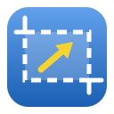
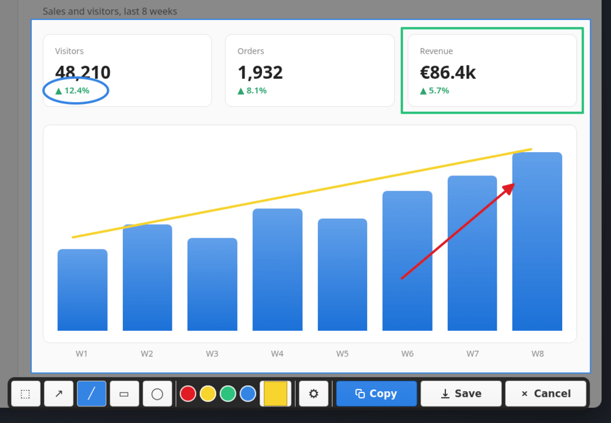
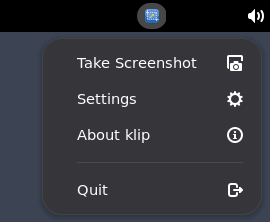
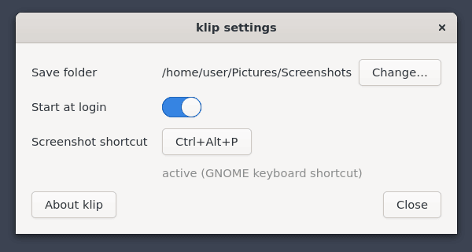

<p align="center">
  
</p>

<h1 align="center">klip</h1>

<p align="center">
  <b>A tiny, native Wayland screenshot tool: drag, annotate, copy.</b>
</p>

<p align="center">
  <a href="https://github.com/schonbeck/klip/releases/latest"></a>
  <a href="https://github.com/schonbeck/klip/actions/workflows/ci.yml"></a>
  <a href="LICENSE"></a>
</p>

<p align="center">
  
</p>

## ✨ Features

- ⌨️ **One shortcut**: press **Ctrl+Alt+P**, drag a rectangle, done.
- ✏️ **Annotate**: arrow, line, rectangle and ellipse, in any color.
- 📋 **Copy** to the clipboard or 💾 **Save** a PNG to `~/Pictures/Screenshots`.
- 🖥️ **Native Wayland** via the screenshot portal: GNOME first, also KDE and wlroots.
- 🧩 **Tray icon**, start at login, no setup questions.
- 🪶 **Small and fast**: one Rust + GTK4 binary.

## 📦 Install

**Homebrew** (Linux, prebuilt bottle):

```sh
brew install schonbeck/tap/klip
klip
```

**Ubuntu 26.04 / Debian** (amd64): get the `.deb` from the
[latest release](https://github.com/schonbeck/klip/releases/latest), then

```sh
sudo apt install ./klip_*_amd64.deb
klip
```

The first `klip` starts klip in the background (tray icon, shortcut, start at
login) and takes a screenshot. To build from source, see
[docs/development.md](docs/development.md).

## 🚀 Usage

Press **Ctrl+Alt+P** (or run `klip`, or click klip in the app grid). The
screen freezes; drag a rectangle and a toolbar appears:

| Action | Button | Keys |
| --- | --- | --- |
| Copy to the clipboard and close | **Copy** | Enter, Ctrl+C |
| Save a PNG and close | **Save** | Ctrl+S |
| Close without copying | **Cancel** | Esc |
| Select / Arrow / Line / Rectangle / Ellipse | ⬚ ↗ ╱ ▭ ◯ | S, A, L, R, E |
| Colors | swatches, color button | 1-4 |
| Undo | | Ctrl+Z |



klip stays in the **tray**: click the icon for **Take Screenshot**,
**Settings**, **About klip** and **Quit**.

```sh
klip             # take a screenshot
klip --settings  # open the settings
klip --help      # all options
```

<br clear="right">

## ⚙️ Settings



Open them from the toolbar's ⚙, the tray, or `klip --settings`: the save
folder, start at login and the screenshot shortcut. Changes apply right away
and are stored in `~/.config/klip/config.ini`.

## 📚 More

- [How it works](docs/how-it-works.md): portals, the background klip, global
  shortcut (gsettings vs. GlobalShortcuts portal), permissions, known limits.
- [Upgrading](docs/upgrading.md) from older versions.
- [Development](docs/development.md): building, code layout, packaging,
  releases and Homebrew bottles.

## 📄 License

[MIT](LICENSE)
